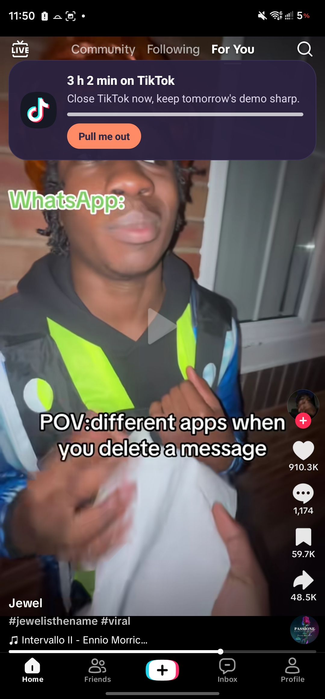
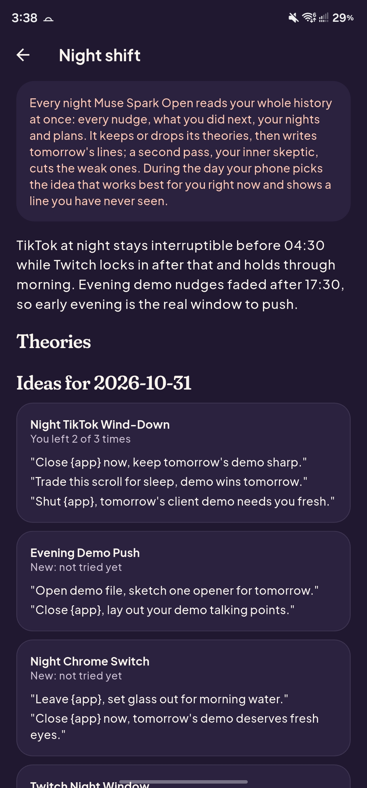
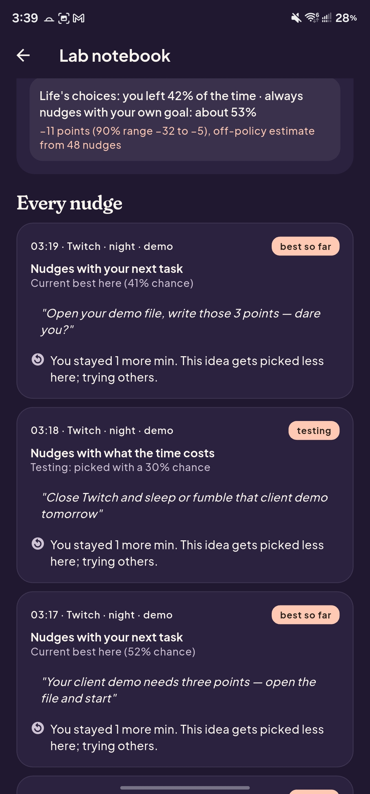
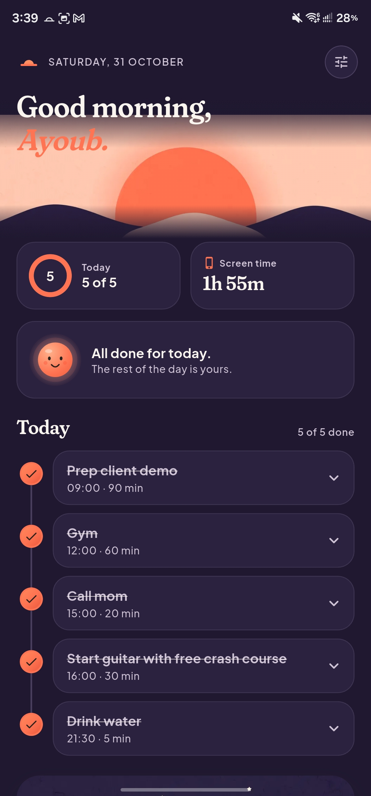
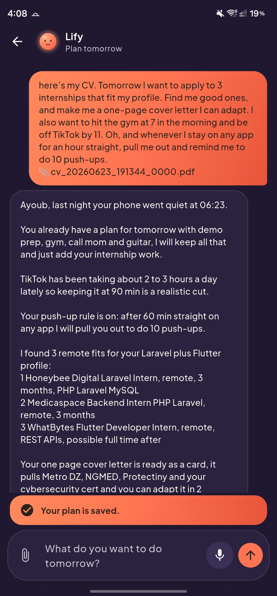
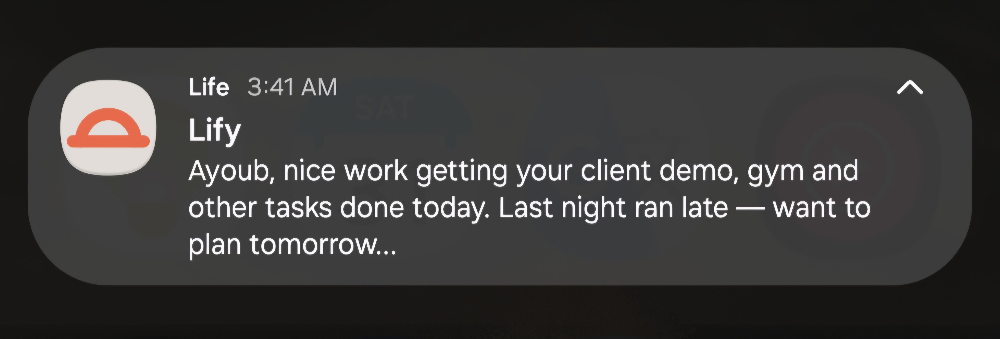

<p align="center">
  
</p>

<h1 align="center">Life</h1>

<p align="center">
  <b>An autonomous, self-learning personal agent.</b><br/>
  <b>Life</b> is the app. <b>Lify</b> is the agent inside it: it plans your day with you, steps in when you're stuck
  scrolling, and learns every night what works on you.<br/>
  Powered by Meta's <b>Muse Spark</b>, <b>Muse Spark Open</b>, <b>Muse Image</b> and <b>Muse Voice Transcribe</b>.
</p>

<p align="center">
  
  
  
  
  
  <a href="https://github.com/ayoubna99/life-agent/actions/workflows/tests.yml"></a>
</p>

<p align="center">
  <a href="#-demo">Demo</a> ·
  <a href="#-measured-on-a-real-phone">Measured</a> ·
  <a href="#-the-night-shift-lify-is-a-scientist-and-you-are-its-only-subject">The night shift</a> ·
  <a href="#-moments-one-fact-thats-true-only-for-you-right-now">Moments</a> ·
  <a href="#-why-it-matters">Why it matters</a> ·
  <a href="#-how-life-uses-metas-muse-models">Meta's Muse</a> ·
  <a href="#-under-the-hood">Under the hood</a> ·
  <a href="#-architecture">Architecture</a> ·
  <a href="#-how-judges-can-verify">Verify it</a> ·
  <a href="#-validate-with-your-own-meta-key">Your own key</a> ·
  <a href="#-permissions-what-life-needs-and-why">Permissions</a> ·
  <a href="#-you-stay-in-control">Your control</a> ·
  <a href="#-privacy">Privacy</a>
</p>

---

> It's 1 AM. You said you'd be off your phone by 11. You've been on TikTok for two hours.
>
> A card slides over the video: **"Gym at 6. TikTok will still be here."** One button: **Pull me out**.
>
> You've never seen that sentence before. Lify wrote it last night, after studying the last 30 nudges it sent you
> and finding the ones that actually made you put the phone down.

**Life is not a planner with a chatbot on top.** It is a closed loop that runs on your phone every day:

| | |
|---|---|
| 👀 **It watches** | Real screen time from Android's usage events: which app, for how long, and when your phone went quiet last night. |
| ✋ **It steps in** | A personal card on top of the app you're stuck in, at the right moment, with one tap to get out. |
| 📏 **It measures** | Did you leave the app right after (within 2 minutes; 20 seconds in demo mode), and stay off the feeds? Going straight back to TikTok or Instagram within 10 minutes doesn't count. Your phone's own usage data says so. |
| 🌱 **Day one** | Before Lify knows you, it starts from what tends to work for most people: concrete next steps, short and direct lines. Then it shifts to what works on you. |
| 🧪 **It learns** | Every night Muse Spark Open reads your whole history, proposes **theories about you**, verifies them against your results, and writes tomorrow's experiment. |

Planning your day, alarms and study material are there too, but they serve this loop. The agent's job is to get you
off the phone and onto what you said matters.

---

## 📝 Hackathon disclosure

Before the hackathon I built an early prototype of this idea: an Android app with Google login, a screen-time
display and app limits with generic notifications. Its backend only handled the Google sign-in: no other APIs, no
data processing. It had **no AI agent and no AI features of any kind**.

**Everything in this repository is brand new and was built during the hackathon:**
- a new codebase, written from scratch: no code from the prototype is reused;
- a new stack (Flutter + Kotlin, Supabase Edge Functions and Postgres, Meta's Muse Spark, Muse Spark Open, Muse Image and Muse Voice Transcribe);
- a new UI, new screens, a new logo and new branding;
- everything that makes Life what it is: the agent Lify, the night shift, the theories verified on real results, the
  experiments with Thompson sampling, the off-policy evaluation, the personal nudge cards and the phone-down nights.

This repository starts at the tag [`hackathon-start`](https://github.com/ayoubna99/life-agent/tree/hackathon-start),
its first commit (26 Oct 2026). I worked locally and pushed in large batches, so each commit holds a lot of work; the
commit dates, the [day-by-day migrations](supabase/migrations) and the tests show how it was built.

---

## 🎬 Demo

> **[▶ Watch the 3-minute demo](https://www.youtube.com/watch?v=7L-o6Q0FkuQ&t=3s)** · **[⬇ Download the APK](https://github.com/ayoubna99/life-agent/releases/latest)**
> (Android 10+; install it, then follow [How judges can verify](#-how-judges-can-verify))

The demo opens with Jake showing the problem: scrolling at night and the "let's plan tomorrow" notification.
Then it's the real app on a real phone:
- planning tomorrow by voice, with a PDF in and a PDF out;
- a nudge card sliding over TikTok, and **Pull me out**;
- Your path (the step-down targets);
- the night shift, and Lify's theories verified on real results.

<p align="center">
  
  
  
</p>
<p align="center">
  
  
  
</p>

---

## 📈 Measured on a real phone

A working-system check on one Samsung phone, during development (late October 2026). It shows that the loop runs end
to end on a real device; it is not a study of whether Life changes anyone's habits.

| What | Result |
|---|---|
| Nudges shown and measured by the phone (outside demo mode) | **39**: each one logged with its moment, its words and what happened next |
| Left the app right after the nudge | **18 of 39 (46%)**, measured by Android's usage events. A control group is now built in (about 1 in 10 nudges held back on purpose); once it has enough data, the lab notebook shows the real effect of a nudge. |
| Night shift, end to end | Muse Spark Open read the history, wrote theories and the nudge bank, and the critic finished **41 s** after the draft was saved |
| The bank in use | Ideas from the night shift were shown and scored (in demo mode): the "late-night TikTok" idea got the user to leave **2 of 3** times |

Every number above comes from the app's own logs; the queries are in [docs/MEASURED.md](docs/MEASURED.md).

---

## 🧪 The night shift: Lify is a scientist, and you are its only subject

Most "AI nudge" apps send the same kind of message forever. Life runs the scientific method on one person, every
night: Muse Spark Open proposes theories about you, and every one is verified against your real results.

```
          ┌───────────── THE NIGHT SHIFT · Muse Spark Open, reasoning_effort "medium" ─────────────┐
 your     │ 1. READ      every nudge it ever sent you + what you did next, your nights, your plans   │
 whole ──►│              ONE request, 1M-token context, no retrieval, no summaries in between        │
 history  │ 2. THEORIZE  testable claims: WHEN (app, time of day, weekday/weekend, how far over the  │
          │              limit, task coming up) + WHAT (tone, topic) works better than the rest       │
          │              e.g. "TikTok, at night, way over: blunt lines about tomorrow's task"         │
          │ 2b. VERIFY   on your real results: Beta posteriors for "with it" vs "without it" in those │
          │              exact moments → P(true). ≥90% kept, ≤10% rejected. "left 5/7 vs 1/6"         │
          │ 3. DESIGN    tomorrow's NUDGE BANK: ~30 short lines grouped by ANGLE (the idea behind     │
          │              them). Winning angles get new words; 1-2 new angles to test; losers dropped  │
          │ 4. CRITIC    a second pass plays your "inner skeptic" (reasoning "low") and cuts every    │
          │              line that is generic, preachy or repeated                                   │
          │ 5. CHECK     ≤12 words, no minute counts, no "you're at your limit", no health language,  │
          │              never a line you've already seen. Every line is checked before it's used.    │
          └──────────────────────────────────────┬─────────────────────────────────────────────────┘
                                                 ▼  the bank goes to the phone
          ┌───────────── DURING THE DAY · on the phone, instant, works offline ───────────────────────┐
          │ stuck on TikTok → Thompson sampling over ANGLES picks the idea most likely to work on you │
          │ HERE (this app, this time of day) → shows a line from it you've never seen → measures     │
          │ whether you left. The idea that works keeps coming back, always in new words.             │
          └──────────────────────────────────────┬─────────────────────────────────────────────────┘
                                                 ▼  results go back up, and the next night checks the theories
```

In the app, **"Lify's theories about you"** says when it was written and what it read ("written at 22:48 by Muse Spark
Open after reading 39 nudges and 7 nights in one request"), shows how each theory moved since last night ("testing 54% →
kept 93%", or "new tonight"), and lists the lines the critic threw out, crossed out, with its reason. Every theory shows
the probability it's true, computed from your results, and the counts behind it ("Checked on your data: left 5/7 with it vs 1/6 without (TikTok, at night)"). When the data disagrees with
the first guess, it says so: *Lify guessed "kept"; your results say "rejected"*. You also see tomorrow's ideas with "you left 4
of 6 times", Lify's **starting assumptions** about most people, and **"How Lify thought about it"**: an excerpt of the
open model's own visible reasoning.

**Why the hour and the app matter:** TikTok at 1 AM on a weekday, 40 minutes over the limit, the night before the gym,
is not TikTok on a Sunday morning. Every nudge is logged with its moment (app, time of day, weekday or weekend, near or
way over the limit, important task within 2 hours) and the tone and topic of the line. Theories are checked only on the
moments they are about.

**Learning from "most people" without anyone's data:** before you have results, each idea starts from a small
**starting assumption** (for example, a concrete next step tends to beat general advice), worth about 3 nudges. The
learning has three levels, each borrowing from the one above until it has its own data:
**most people → you everywhere → you on this app at this time.** Your results outweigh the assumptions within a day or
two. The top level can later take anonymous totals from all Life users (opt-in).

Code: [`nightshift.ts`](supabase/functions/_shared/nightshift.ts) · [`theories.ts`](supabase/functions/_shared/theories.ts) ·
[`Bank.kt`](app/android/app/src/main/kotlin/org/ngdev/life_agent/core/Bank.kt) ·
[`LimitWatcherService.kt`](app/android/app/src/main/kotlin/org/ngdev/life_agent/LimitWatcherService.kt)

---

## 🎯 Why it matters
- **Less, one step at a time, using a known method.** Life uses the **changing-criterion** method (step-by-step
  targets, each one earned). It starts from your *typical* day (the median of the last 7, not your worst), sets a target about 15% lower,
  and steps down again only after you hit it on 2 of the last 3 days. A missed day never raises it, and it stops at your
  own goal: the aim is less, not zero. When a target drops, **Muse Spark Open** writes what to do
  with the minutes you won back, from your own plan ("25 minutes back: two pages of your thesis at 22:15"). That is an
  implementation intention, and the nudge at the target uses it. Home shows it as **Your path**:
  *TikTok: 3 h → 2 h 35 → today 2 h 10 · goal 30 min*.
- **The problem everyone has:** hours a day lost to scrolling, and the knowledge that it's happening doesn't stop it.
  Screen-time apps show charts or block apps; people ignore the charts and switch the blocker off.
- **Life doesn't lock your apps: it gets you to leave them yourself.** A personal line at the right moment and one tap
  out, then it checks whether you actually left, and gets better at it every night.
- **It works on what you care about:** every nudge points at your own goal, tomorrow's plan, or your real phone-down
  time last night ("Phone down at 03:30 last night. Tonight?"). Never a generic "take a break".
- **It respects you:** at most 4 nudges per app per day, at least 20 minutes apart, spaced further out the longer you go
  over (+15, +45, +105 minutes). A rule you set for an app ("every 30 minutes on TikTok, get me out") replaces that
  app's limit nudges.

---

## 💡 Moments: one fact that's true only for you, right now

Generic nudges could be sent to anyone. A moment carries one fact that is only true for this person at this second.
The phone works out the fact from its own data; **Muse Spark Open** turns it into a line; the server keeps that line
only if every number in it is one of the real facts.

| Moment | When | Example | Button |
|---|---|---|---|
| **Lost intent** | You picked the phone up for one app and drifted into feeds | *"You picked up your phone for WhatsApp 14 minutes ago. Since then: Instagram, then TikTok."* | **Back to WhatsApp** |
| **Your exit point** | This session passed the minute you usually leave on your own | *"You usually leave TikTok around minute 6. This is minute 9."* | **Open:** your next task |
| **Planned now** | Your own plan says this time is for a task | *"You planned 'Finish chapter 3' for 21:00. It's 21:10."* | **Open: Finish chapter 3** |
| **Phone-down** | You're past the phone-down time you chose | *"You said phone down at 23:00. Tomorrow starts with Gym at 07:00."* | **Done for tonight** |

Thompson sampling learns which moment works on you, and the night shift writes theories about them.

---

## 🧠 How Life uses Meta's Muse models
Four Meta models, each used for what it is uniquely good at:

| Model | Job in Life | Why this model |
|---|---|---|
| **Muse Spark** (Chat Completions, Responses) | The agent: planning chats with 18 tools (calendar, alarms, app limits, PDFs, documents), web search with sources, reading photos and scanned PDFs | Agentic tool calling, multimodal input |
| **Muse Image** (Image generation) | Pictures Lify makes for your day and your tasks | Image generation |
| **Muse Voice Transcribe** (Transcribe) | Talk to Lify instead of typing | Speech to text |
| **Muse Spark Open** (open weights, served on **Baseten**) | **The night shift** (theories + nudge bank + critic), live nudges, the evening "let's plan tomorrow" notification | **1M-token context:** reads your whole history at once instead of retrieval. **Controllable reasoning:** thinks hard at night (`medium`), almost not at all for live nudges (`low`). **Visible reasoning:** shown in the app as "how Lify thought about it". **Open weights:** Life runs it on Baseten's inference platform, one of Meta's launch partners, and the same pipeline can be self-hosted so your history never leaves your servers. |

- Muse Spark and Muse Spark Open back each other up, so a nudge still arrives if one is down.

**Talk to Lify any way you like, and get back what you need:**

| You send | What reads it | Lify sends back | What makes it |
|---|---|---|---|
| Text | Muse Spark | A plan, tasks, alarms, app limits, your own rules | Muse Spark (tool calls) |
| Your voice | **Muse Voice Transcribe** | Spoken answers | the phone's voice |
| A PDF (a CV, a course, an article) | Text PDFs read on the server; scanned ones by **Muse Spark** (vision) | A real **PDF** (a study sheet, a cover letter) | Muse Spark writes it, the server lays it out |
| A photo (timetable, whiteboard, notes) | **Muse Spark** (vision) | A **picture** (a card for your day) | **Muse Image** |
| A link, or "find me…" | the server reads the page; **Muse Spark web search** with sources | Links in the task, checked before they're saved | Muse Spark |
- Code: [`muse.ts`](supabase/functions/_shared/muse.ts) (routing, failover, reasoning effort),
  [`nudge.ts`](supabase/functions/_shared/nudge.ts), [`evening.ts`](supabase/functions/_shared/evening.ts).

---

## 🔧 Under the hood
Muse writes, plans and forms theories; Life's engine tests, measures and learns from every result.

1. **Contextual Thompson sampling with a 3-level prior (phone, Kotlin):** each idea has a Beta posterior for this app at
   this time of day. Its prior comes from your other moments, and theirs from a starting assumption about most people
   (hierarchical shrinkage), so a new user and a new moment start from what is already known.
2. **Theories verified on real results (server):** every theory must be testable (moments + property). Life compares
   "with it" vs "without it" in exactly those moments with Beta posteriors and 4000 seeded joint draws, and sets the
   status and confidence. The tests show the model's own "kept 95%" being overruled by the data.
3. **Propensity logging:** the chance of each choice is computed by Monte Carlo (400 draws) and logged with the result.
4. **Off-policy evaluation (server):** self-normalised inverse propensity scoring estimates how "always send style X"
   would have done on the same moments. Life's lift over the best fixed nudge comes with a 90% bootstrap interval. The
   tests check that the estimator recovers known rates from heavily biased logs.
5. **A real control group:** about 1 in 10 nudges is held back on purpose (no card) and only measured. The lab notebook
   compares "with a nudge" vs "without one", so Life can show what its nudges actually add, not just how often people
   left anyway.
6. **Facts computed in code, phrased by Muse:** a moment's numbers come from the phone's own data; any line from the
   model with a number that isn't one of those facts is thrown away.
7. **Strategy memory:** each evening review writes a new strategy version. The server refuses any change that doesn't
   cite a number, and every version is kept (day 1 vs. today).
8. **Real Android engineering:**
    - a foreground watcher reading `UsageStatsManager` events;
    - a custom overlay card with a "Pull me out" button. On phones that hide overlays it falls back to a heads-up notification automatically;
    - a watchdog alarm that restarts the watcher if the phone kills it;
    - exact alarms and real Clock-app alarms;
    - phone-down detection from unlock events, which ignores notification wake-ups, alarms and calls.
9. **Production basics:**
    - anonymous auth with row-level security on every table;
    - per-user and global daily caps;
    - keys only in server secrets;
    - every link checked before it is saved;
    - 400+ automated tests.
10. **Open source:** [MIT license](LICENSE).

Code: [`Experiment.kt`](app/android/app/src/main/kotlin/org/ngdev/life_agent/core/Experiment.kt) ·
[`experiments.ts`](supabase/functions/_shared/experiments.ts) · [`strategy.ts`](supabase/functions/_shared/strategy.ts) ·
[`Nights.kt`](app/android/app/src/main/kotlin/org/ngdev/life_agent/core/Nights.kt)

---

## 🔬 Why nudges can work, and why Life tests them on you

Pop-ups and limits measurably reduce phone use. But nudge effects vary a lot between people, so Lify doesn't assume
any nudge works: it tests them on you, the way researchers do in micro-randomized trials.

- **Pop-ups reduce app use.** In a 6-week field study with 280 people, a pop-up before a chosen app
  made people close it 36% of the time, and actual openings fell 57%
  ([Grüning et al., PNAS 2023](https://doi.org/10.1073/pnas.2213114120)). The easy exit was the
  strongest ingredient, not the message. That's why Life's card leads with one tap: **Pull me out**.
- **People want limits.** When about 2,000 Android users were offered a tool to set their own app limits,
  89% used it and their social media time fell 17%
  ([Allcott, Gentzkow & Song, AER 2022](https://doi.org/10.1257/aer.20210867)).
- **Just-in-time suggestions work, then fade.** In the HeartSteps micro-randomized trial, walking
  suggestions raised the next 30 minutes' steps, but the effect shrank over the weeks
  ([Klasnja et al., 2019](https://pmc.ncbi.nlm.nih.gov/articles/PMC6401341/)). Life uses the same
  design (randomize at each moment, measure the next minutes) and keeps the wording fresh.
- **Nudge effects vary a lot between people.** Across 200+ studies the average effect is small to medium,
  and much smaller after correcting for publication bias
  ([Mertens et al., PNAS 2022](https://doi.org/10.1073/pnas.2107346118);
  [Maier et al., PNAS 2022](https://doi.org/10.1073/pnas.2200300119)).
  So Life doesn't assume any nudge works. It measures what works for each person.

*These studies support the approach, not Life's exact numbers: one sec steps in when you open an app,
Life steps in after you've been in it for a while.*

---

## ✨ Everything Life does

- **Plans tomorrow with you** (text or voice, a notification one hour before your bedtime). It checks your calendar,
  estimates task durations itself, and puts tasks and alarms on the phone the moment the plan is saved.
- **Picks the right alarm per task:** a real Clock alarm for things away from the screen (gym, prayer, leaving home),
  or an in-app alarm that opens the task's own screen with everything ready (links, PDFs, pictures, steps, chat notes).
- **Makes what you need:** study sheets as real PDFs and pictures. It reads web pages, PDFs and photos you send, and searches the web with sources.
- **Your own rules:** "whenever I'm on any app for 30 minutes straight, pull me out" becomes a rule on the phone. Short
  breaks (the screen going off, a quick reply) don't reset the count.
- **Step-down targets:** each distracting app's daily target goes down one earned step at a time (see Impact), with
  Muse Spark Open's trade for the minutes you win back.
- **Knows your nights:** when the phone went quiet and was picked up again, measured from unlock events.
  "Phone down at 03:30 last night. Tonight?"
- **Learns:** the night shift, the lab notebook (every nudge, why it was picked, what you did next), and the strategy
  memory with every version kept.
- **Talks:** voice in (Muse Voice Transcribe), voice out.
- **Check Lify:** a self-diagnosis screen showing the account, server, watcher, battery and pop-up permissions, your last
  nights, and a log of every nudge (shown as a card or a notification, or skipped and why), with Fix buttons.

---

## 🏗 Architecture

Meta's Muse models are the brain of Life at every moment of the day: they listen, read, plan, act on your phone, study
you overnight and write every line you see. The phone and the server give them senses, hands and a memory.

```
┌─ EVENING · you talk to Lify (voice, text, a PDF, a photo) ─────────────────────────────────────┐
│ MUSE VOICE TRANSCRIBE   your voice → text                                                      │
│ MUSE SPARK (agent)      reads your CV, notes and photos (vision), searches the web (sources),  │
│                         plans tomorrow with you, writes study sheets as PDFs, and ACTS on your │
│                         phone with 18 tool calls: tasks, alarms, app limits, calendar, rules   │
│ MUSE IMAGE              pictures for your day and your tasks                                   │
└────────────────────────────────────────────────────────────────────────────────────────────────┘
                                                │
                                                ▼  tomorrow is on your phone the moment the plan is saved
┌─ NIGHT SHIFT · Muse Spark Open on Baseten studies you (1M-token context, reasoning "medium") ──┐
│ reads ALL of it in one request: every nudge + what you did next, nights, plans, your path      │
│ → THEORIES about what gets you off your phone, and when   → verified against your results      │
│ → tomorrow's NUDGE BANK: fresh lines grouped by idea     → a critic pass cuts weak lines       │
│ → the minutes you won back on Your path become a plan ("25 min back: 2 pages at 22:15")        │
└────────────────────────────────────────────────────────────────────────────────────────────────┘
                                                │
                                                ▼  the bank and today's targets go to the phone
┌─ DAY · on your phone (Kotlin), instant, works offline ─────────────────────────────────────────┐
│ usage watcher sees TikTok at 1 AM, 40 min over today's target                                  │
│ → Thompson sampling picks the idea most likely to work on you HERE → a line you've never seen  │
│ → the card slides over TikTok: "Gym at 6. TikTok will still be here."  [Pull me out]           │
│ → no line fits? MUSE SPARK OPEN writes one live (reasoning "low", lands in seconds)            │
│ → did you leave? measured from Android's usage events                                          │
└────────────────────────────────────────────────────────────────────────────────────────────────┘
                                                │
                                                ▼  every result goes back up: tonight's night shift learns from it
┌─ SUPABASE · the memory ────────────────────────────────────────────────────────────────────────┐
│ Edge Function "agent" (agent loop, 3 modes, night shift, theory checks, off-policy evaluation) │
│ Postgres + row-level security: plans, chats, strategies, nudges + outcomes, nights, shifts,    │
│ step-down paths · Storage: PDFs and pictures (deleted after 3 days)                            │
└────────────────────────────────────────────────────────────────────────────────────────────────┘
```

- **Three agent modes, one agent:**
    - **planning** (evening): asks until it has everything, then saves the plan;
    - **execute** (morning): sets up the day on the phone through device tool calls;
    - **review** (evening): compares the plan with real usage and updates the strategy.
- **The server remembers the conversation;** the phone sends only new messages and tool results.
- **API reference:** [docs/API.md](docs/API.md).

| Path | What |
|---|---|
| `supabase/functions/_shared/` | prompts, tools, agent loop, Muse clients, night shift, experiments and evaluation |
| `supabase/migrations/` | Postgres schema with row-level security |
| `tests/` | backend tests with a scripted model and an in-memory store (no network, no keys) |
| `app/lib/` | Flutter: screens, agent client, device tools, plan applier |
| `app/android/.../kotlin/` | Kotlin: watcher, Thompson sampling, nudge bank, overlay card, alarms, nights |
| `docs/API.md` | every request and answer |

---

## 🚀 Run it

**Backend** (Node 22.6+ and the Supabase CLI):
```
npm install
npm test
npx supabase link --project-ref YOUR_PROJECT_REF
npx supabase db push
npx supabase secrets set MUSE_BASE_URL=... MUSE_API_KEY=... MUSE_MODEL=... OPEN_API_KEY=...
npx supabase functions deploy agent
```
Turn on *Anonymous sign-ins* in Supabase Authentication.

**App** (Flutter 3.41+, Android SDK):
```
cd app
flutter pub get
flutter run --release --dart-define=SUPA_KEY=sb_publishable_YOUR_KEY
```
See [app/README.md](app/README.md) for permissions and first run.

---

## 🔍 How judges can verify

1. **Install the [APK](https://github.com/ayoubna99/life-agent/releases/latest)** on an Android phone (Android 10+).
   No Android phone? Install [Android Studio](https://developer.android.com/studio) (free, Mac or Windows), open
   **Device Manager**, start an emulator (any phone with Android 10+), and drag the APK onto it.
2. Finish the 5 onboarding slides. Allow **Usage access**, **Show over other apps** and **Notifications**. In Settings
   → Check Lify, set **Battery** to unrestricted.
3. **Talk to Lify:** tap *Plan tomorrow* and plan by voice or text. Saving the plan puts tomorrow's tasks and alarms on
   the phone right away (check your Clock app).
4. **See a nudge:** Settings → Experiments → turn on *Experiments*, then *Demo mode*. Open one of the apps you chose
   for about 20 seconds. A card slides in with **Pull me out**.
5. **See the night shift:** Home → TEST → **Night shift (test)** (up to 2 minutes), then open *Lify's theories about
   you*: theories verified on your results, tomorrow's lines, and "How Lify thought about it".
6. **See everything that happened:** Settings → Check Lify → *What the watcher did*.
7. **Run the tests:** `npm test` (backend), `cd app && flutter test` (app). They also run on every push:
   [GitHub Actions](https://github.com/ayoubna99/life-agent/actions/workflows/tests.yml).

The judging build uses a shared demo backend with a daily cap per user, so a judge's account works on its own.

---

## 🔑 Validate with your own Meta key

You can download the ready-to-use APK from [Releases](https://github.com/ayoubna99/life-agent/releases/latest): it works
as is, nothing to set up. If you want to use your own keys, follow these steps. No code changes are needed: every key is
a server secret.

**1. Backend (about 10 minutes)**: a free Supabase project, Node 22.6+:
```
git clone https://github.com/ayoubna99/life-agent && cd life-agent
npm install
npx supabase login
npx supabase link --project-ref YOUR_PROJECT_REF
npx supabase db push
npx supabase secrets set MUSE_BASE_URL=https://.../v1 MUSE_API_KEY=YOUR_META_KEY MUSE_MODEL=YOUR_MUSE_SPARK_MODEL
npx supabase functions deploy agent
```
In Supabase → Authentication → Providers, turn on **Anonymous sign-ins**.
Optional, for Muse Spark Open: `npx supabase secrets set OPEN_API_KEY=YOUR_BASETEN_KEY`.
Without it, every job (including the night shift) runs on Muse Spark.

**2a. Quick check from a terminal, no phone needed.** It talks to your backend exactly like the app does:
```
$env:SUPA_URL = "https://YOUR_PROJECT_REF.supabase.co"; $env:SUPA_KEY = "sb_publishable_..."
node scripts/chat.mjs --fake-usage                             # planning chat with tool calls
node scripts/chat.mjs --voice C:\path\recording.wav            # Muse Voice Transcribe
node scripts/chat.mjs --attach C:\path\notes.pdf               # reading a PDF or a photo
node scripts/chat.mjs nudge --app TikTok --used 52 --limit 30  # the line a nudge card would show
.\scripts\smoke.ps1                                            # the whole flow in one go
```

**2b. The full app on your backend:**
```
cd app
flutter build apk --release --dart-define=SUPA_URL=https://YOUR_PROJECT_REF.supabase.co --dart-define=SUPA_KEY=sb_publishable_...
```
Install `app/build/app/outputs/flutter-apk/app-release.apk` and follow the steps in
[How judges can verify](#-how-judges-can-verify).

---

## 📱 Permissions: what Life needs, and why

Life asks for each permission on its own screen and explains it first. Only **Usage access** is needed for the core
loop; everything else makes Life better but is optional. Settings → Check Lify shows which ones are on, with a Fix button.

| Permission | Why | Needed? |
|---|---|---|
| **Usage access** | To see which app is in front and for how long (never what's in it). Screen time, nudges, nights and step-down targets all come from this. | **Required** |
| **Notifications** | The evening "let's plan tomorrow" notification, reminders, and nudges when a card can't be shown | Recommended |
| **Show over other apps** | The nudge card on top of the app you're in. Without it, nudges come as notifications. | Optional |
| **Alarms and reminders** (exact alarms) | In-app task alarms at the exact minute, and the evening notification on time. Without it, Life can't set in-app task alarms (Clock-app alarms still work). | Recommended |
| **Battery: unrestricted** | Some phones (Samsung, Xiaomi) stop background apps, and the watcher with them. | Optional, recommended |
| **Calendar** (read only) | Plan around your real events, and remind you before them | Optional |
| **Microphone** | Talk to Lify instead of typing | Optional |
| Internet, run in the background, start after a reboot, set a Clock alarm | Granted by Android automatically, no prompt. The background watcher shows a silent "Life" notification, as Android requires. | Automatic |

Life never asks for contacts, location, SMS, the camera roll or your accounts. Photos and PDFs are only read when you
pick them yourself.

---

## 🧭 You stay in control

Lify acts on what you ask it for: the plan you make with it, the rules you set. Everything else can be turned off or
changed in Settings.

- **Choose which apps it watches:** only the apps in *Apps that pull me away*. Take one off the list and its limits and
  nudges go too.
- **Nudges as notifications:** prefer a notification to a card over the app? One switch in Settings → Check Lify.
- **Your own rules:** see them in Settings → *Your reminders* and remove any of them there, or just ask Lify.
- **Experiments off:** nothing about your nudges is sent to the server; the learning stays on your phone.
- **Every alarm is a normal one:** phone alarms are in your Clock app, where you can change or delete them like any other.
- **The silent "Life" notification:** Android requires it while the watcher runs; you can hide its category in your
  phone's notification settings.
- **Your data:** see [Privacy](#-privacy) for what is stored and how to delete it.

---

## 🔒 Privacy

| What | Where it goes | Kept |
|---|---|---|
| Screen time: minutes per app per day (never what you watch) | Supabase (your private rows, row-level security) | Until deleted |
| When the phone went quiet each night (two times, no content) | Supabase | Until deleted |
| Plans, chats, your settings (name, sleep time, apps, focus) | Supabase; chats go to **Muse Spark** (Meta) to answer | Until deleted |
| Live nudges and the evening notification: your plan, settings and the last few nudge lines | **Muse Spark Open on Baseten**, to write the line | Not stored by Life outside Supabase |
| Each nudge: app name, time, the words, whether you left | Supabase | Until deleted |
| **Night shift:** the last 30 days of the rows above, sent once a night | **Muse Spark Open on Baseten** (inference only) | Not stored by Life outside Supabase; see Baseten's terms |
| Voice recordings | Transcribed by Muse Voice Transcribe, then **deleted** | Not kept |
| Photos, PDFs you send | Read, kept as text; photos deleted after reading | Files: 3 days |

- **Never collected:** the content of other apps, what you watch, messages, location, contacts. The watcher only sees which
  app is in front and for how long, from Android's usage statistics.
- **Accounts are anonymous:** no email, no phone number. The account lives on your phone.
- **Delete your data:** email the first 8 characters of your account id (Settings → Check Lify → Account) to
  ayoub.nadjem09@gmail.com. Deleting the account removes every row about you (every table is linked to it and deleted
  with it) and your files. A one-tap "Delete my data" button is next on the list.
- **"Totals from all users"** is a design option only. Nothing is pooled today. If it is ever built, it will be
  opt-in and share only counts per kind of nudge, nothing personal.
- **Open weights:** because Muse Spark Open's weights are open, the night shift can run on servers you control, so your
  history never leaves them. The code needs only a different `OPEN_BASE_URL`.

---

## 📊 Status

- **Tested end to end on a real Android phone (Samsung):**
    - planning chats with live Muse Spark tool calls;
    - Muse Spark Open on Baseten;
    - the night shift and the nudge bank;
    - the nudge cards and "Pull me out";
    - screen time and phone-down nights;
    - the evening notification;
    - alarms and calendar;
    - voice;
    - Check Lify.
- **License:** [MIT](LICENSE).
- **Automated tests:** 400+ (backend, Flutter and Kotlin). The Android code compiles against the real Android 15 classes.
- **Honest about the numbers:** results in the app are labelled "early signal" with sample sizes.
